  

I build and improve B2B SaaS with React, Next.js, TypeScript, Node.js, and NestJS. I work with SQL and NoSQL databases, including PostgreSQL and MongoDB. I have 5+ years of commercial experience across admin tools, billing, analytics, and integrations. Based in Lviv, Ukraine. Open to remote roles and freelance contracts.

  <a href="https://www.sanotskyi.dev/">Portfolio and case studies</a> ·
  <a href="https://www.linkedin.com/in/vasyl-sanotskyi-5267712a8/">LinkedIn</a> ·
  <a href="https://www.upwork.com/freelancers/~01680a199ca9b713f6">Upwork</a>

## Tech stack

  

  

## AI and LLM integrations

I integrate large language models (LLMs) into new and existing applications and have worked hands-on with multiple models.

- **Signal scoring and analytics:** [DecisionSignal](https://www.sanotskyi.dev/work/decisionsignal) uses AI to help score incoming reports and surface trends and anomalies in an analytics dashboard.
- **Document workflows:** My work includes a compliance platform with an AI assistant for working with documents.

## Selected work

- [DecisionSignal](https://www.sanotskyi.dev/work/decisionsignal): Built a multi-tenant admin dashboard, participant PWA, and NestJS API with PostgreSQL and role-based access.
- [Just Fare](https://www.sanotskyi.dev/work/just-fare): Built catering operations tools, consumption reporting, and weekly billing workflows with React and Firebase.
- [Podflow](https://www.sanotskyi.dev/work/podflow): Helped automate catalog imports, product mockups, and publishing across Shopify stores.
- [Fieldspace](https://www.sanotskyi.dev/work/fieldspace): Built booking, memberships, and admin calendar workflows with Next.js and Stripe Connect checkout.
- [Storinky](https://www.sanotskyi.dev/work/storinky): Developed book catalogs, personal libraries, and discovery features with React, Node.js, and MongoDB.

[Read the Fieldspace engineering walkthrough](https://www.sanotskyi.dev/articles/fieldspace-nextjs-stripe-connect)

### GitHub stats

  

  

---

### Contribution Drift

  

---

### Connect

  &nbsp;
  &nbsp;
  &nbsp;
  &nbsp;
  &nbsp;
  

