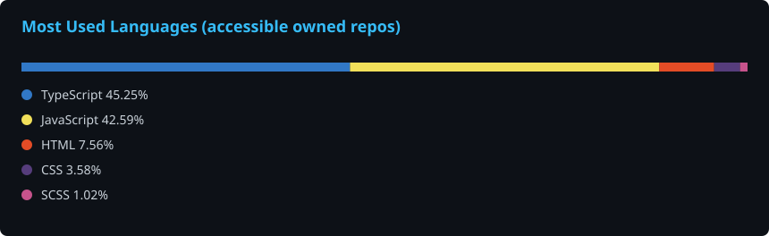

# Vasyl Sanotskyi

Senior Full-Stack Engineer building and improving B2B SaaS with React, Next.js, TypeScript, Node.js, NestJS, and PostgreSQL.

I have 5+ years of commercial experience. I work on existing products as well as new builds, with a focus on admin tools, billing, analytics, and integrations. Based in Lviv, Ukraine. Open to remote full-stack roles and freelance contracts.

## AI and LLM integrations

I integrate large language models (LLMs) into new and existing web applications and have hands-on experience with multiple models. Examples include a document AI assistant in a compliance platform and DecisionSignal, where AI helps score incoming signals and surface patterns and anomalies in the analytics dashboard.

## Selected work

- [DecisionSignal](https://www.sanotskyi.dev/work/decisionsignal): Built a multi-tenant admin dashboard, participant PWA, and NestJS API with PostgreSQL and role-based access.
- [Just Fare](https://www.sanotskyi.dev/work/just-fare): Built catering operations tools, consumption reporting, and weekly billing workflows with React and Firebase.
- [Podflow](https://www.sanotskyi.dev/work/podflow): Helped automate catalog imports, product mockups, and publishing across Shopify stores.
- [Fieldspace](https://www.sanotskyi.dev/work/fieldspace): Built booking, memberships, and admin calendar workflows with Next.js and Stripe Connect checkout.
- [Storinky](https://www.sanotskyi.dev/work/storinky): Developed book catalogs, personal libraries, and discovery features with React, Node.js, and MongoDB.

[Portfolio and case studies](https://www.sanotskyi.dev/) | [Fieldspace engineering notes](https://www.sanotskyi.dev/articles/fieldspace-nextjs-stripe-connect) | [LinkedIn](https://www.linkedin.com/in/vasyl-sanotskyi-5267712a8/)

### GitHub stats

  

  

---

### Contribution activity

  

---

### Connect

  &nbsp;
  &nbsp;
  &nbsp;
  &nbsp;
  &nbsp;
  

